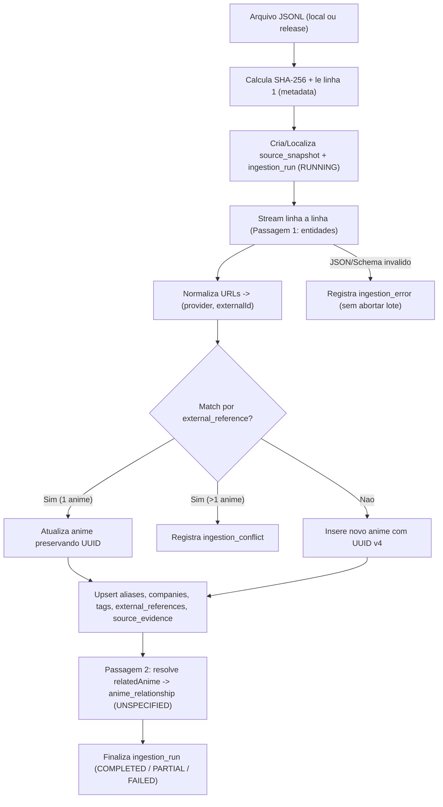

# Fluxo de Dados, Matching e Governança — AnimeVerse Intelligence

**Status:** Aprovado (Fase 02)

---

## 1. Pipeline de ingestão streaming JSONL (`anime-offline-database`)

---

## 2. Regras de identidade e deduplicação

1. **Chave primária interna:** `UUID` gerado internamente (`anime.id`, `company.id`, `tag.id`, `data_source.id`, `source_snapshot.id`, `ingestion_run.id`).
2. **Proibição de título como chave:** títulos nunca definem identidade única (há homônimos e variações de romanização).
3. **Matching forte:** feito exclusivamente por `external_reference` normalizada (`provider` + `externalId` ou `normalizedUrl`).
4. **Conflitos:** se um registro JSONL trouxer duas referências externas já associadas a dois `anime.id` distintos no banco, o importador **não funde nem sobrescreve silenciosamente** — registra em `ingestion_conflict` para revisão.

---

## 3. Proveniência e cache por fonte

- Toda ingestão cria/reutiliza um `source_snapshot` identificado por `(data_source_id, sha256)`.
- Cada anime importado/atualizado recebe vínculo em `source_evidence` apontando para `(entity_type, entity_id, data_source_id, source_snapshot_id)`.
- **Política de cache/armazenamento por fonte:**
  - `anime-offline-database`: `ACTIVE`, `storage_allowed = true`, `cache_ttl_seconds = null` (snapshot persistido sob ODbL 1.0 / DbCL 1.0 com atribuição).
  - `anilist`: `INACTIVE`, `storage_allowed = false` (proibido espelhar em massa).
  - `wikidata`, `mangaupdates`, `tmdb`: `INACTIVE`, `storage_allowed = false` até revisão legal e habilitação explícita pós-MVP.
