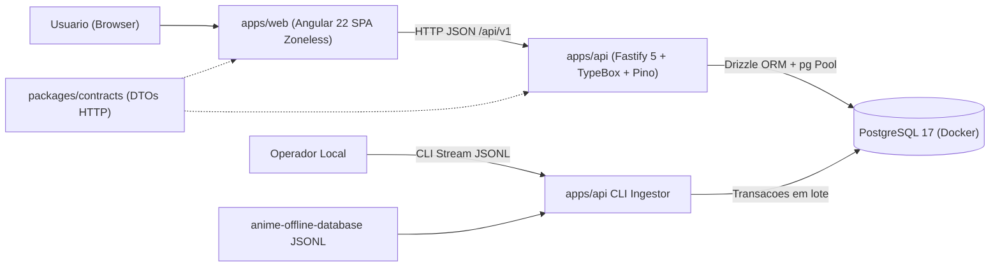

# System Design — AnimeVerse Intelligence

**Status:** Aprovado (Fase 02)  
**Última atualização:** 2026-11-23

---

## 1. Visão geral da arquitetura

O **AnimeVerse Intelligence** é estruturado como um monorepo gerenciado com `pnpm workspaces` contendo:

- `apps/web` — Aplicação Angular 22 standalone, zoneless, baseada em Signals, organizada por features (`catalog`, `relations`, `studios`, `sources`, `lore`, `adaptation`), com Transloco (`pt-BR`/`en`) e temas dark/light.
- `apps/api` — API HTTP modular em Fastify 5 + TypeScript 6 estrito + TypeBox JSON Schema + OpenAPI + Pino + Drizzle ORM (`pg`), além da CLI de ingestão streaming JSONL executada localmente.
- `packages/contracts` — Pacote compartilhado exclusivamente com tipos e contratos estáveis de transporte HTTP (DTOs, enums públicos, paginação, Problem Details). **Nunca** contém schemas Drizzle, migrações ou entidades de persistência.

---

## 2. Organização modular

### 2.1 Backend (`apps/api`)

Estrutura modular por domínio sem camadas cerimoniais excessivas:

- `src/config/` — carregamento e validação estrita de variáveis de ambiente no startup.
- `src/db/` — cliente `pg` pool, instância Drizzle, schema SQL normalizado e runner de migrações versionadas (`drizzle/`).
- `src/plugins/` — plugins Fastify (CORS estrito, Helmet/security headers, rate limit, Swagger/OpenAPI, Problem Details RFC 7807, request-id/Pino redaction).
- `src/modules/` — módulos por domínio (`health`, `catalog`, `companies`, `relations`, `sources`, `enrichment`, `lore`, `adaptation`), cada qual contendo `routes.ts`, `schemas.ts`, `service.ts`, `repository.ts` conforme necessidade.
- `src/cli/` — comandos CLI locais (ex.: `ingest-anime-offline.ts`).
- `src/app.ts` — app factory testável com `fastify.inject` (separada de `src/server.ts`).

### 2.2 Frontend (`apps/web`)

Estrutura feature-first com `.ts`, `.html` e `.scss` sempre separados e interfaces de domínio em `.model.ts`:

- `src/app/core/` — serviços globais (`ApiClientService`, `ThemeService`, `I18n`), interceptors, tokens e layout shell (`Header`, `Nav`, `Footer`).
- `src/app/shared/` — componentes reutilizáveis (ícones SVG consistentes sem emojis, badges de estado, paginação, estado vazio, fallback de imagem, Problem Details alert).
- `src/app/features/` — features isoladas carregadas via lazy routes (`catalog`, `relations`, `studios`, `sources`, `lore`, `adaptation`).

---

## 3. Versões e compatibilidade verificadas no ambiente

Conforme `docs/ENVIRONMENT.md` (Fase 00):

- **Node.js:** `v24.16.0` (compatível com Angular 22 `^24.15.0` e Fastify 5).
- **TypeScript:** `~6.0.0` (`>=6.0.0 <6.1.0`, exigido pelo Angular 22).
- **pnpm:** `11.17.0` com `pnpm-workspace.yaml`.
- **PostgreSQL:** `17-alpine` em Docker Compose (`compose.yaml`).
